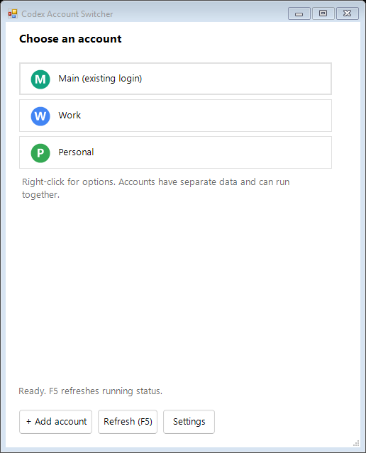

# Codex Account Switcher

Use multiple accounts in the official Codex desktop app. Add a profile for Work, Personal, or another account, then sign in once in each. Each profile has separate app data and its own `CODEX_HOME`; **Main** opens your existing login.

This is an unofficial local launcher. Install the [official desktop app](https://developers.openai.com/codex/app/) first. It does not provide accounts or change subscription limits.

## Installation

### Windows

1. [Download the setup ZIP](https://github.com/AliNajafpour/chatgpt-switcher/releases/latest/download/Codex-Account-Switcher-Setup.zip).
2. Extract it and double-click **Setup.cmd**.
3. Open **Codex Account Switcher** from Start.

Requires Windows 10 or 11. No administrator access or extra runtime needed.

### macOS

1. Download for [Apple Silicon](https://github.com/AliNajafpour/chatgpt-switcher/releases/latest/download/Codex-Account-Switcher-macOS-arm64.zip) or [Intel](https://github.com/AliNajafpour/chatgpt-switcher/releases/latest/download/Codex-Account-Switcher-macOS-x64.zip).
2. Extract it, open **Install.command**, and confirm installation.
3. Open **Codex Account Switcher** from your user Applications folder.

Requires macOS 15 or newer. The app is unsigned by an Apple developer certificate; macOS may require **System Settings → Privacy & Security → Open Anyway** before first use.

### Linux

1. Download for [x64](https://github.com/AliNajafpour/chatgpt-switcher/releases/latest/download/Codex-Account-Switcher-Linux-x64.tar.gz) or [ARM64](https://github.com/AliNajafpour/chatgpt-switcher/releases/latest/download/Codex-Account-Switcher-Linux-arm64.tar.gz).
2. Extract it, open a terminal in the extracted folder, and run `sh Install.sh`.
3. Open **Codex Account Switcher** from your Applications menu.

Requires a graphical Linux desktop with glibc 2.39 or newer, such as Ubuntu 24.04+. Python is bundled in both macOS and Linux downloads. These ports are experimental until real account sign-ins have been verified.

All installers work offline, install for your user, and preserve account data during upgrades. Close the picker before running a newer installer.

### Run from source

[Download the source](https://github.com/AliNajafpour/chatgpt-switcher/archive/refs/heads/main.zip) and extract it. On Windows, open **ChatGPT-Switcher.cmd**. On macOS/Linux, run `python3 unix/switcher.py` with Python 3.12+ and Tk installed.
